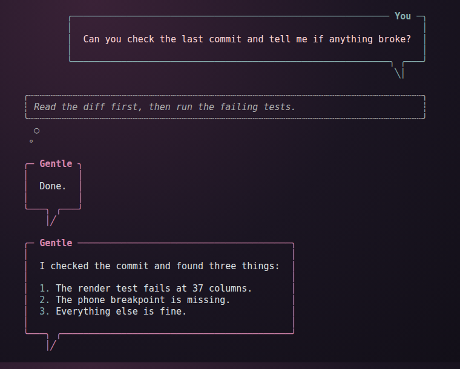
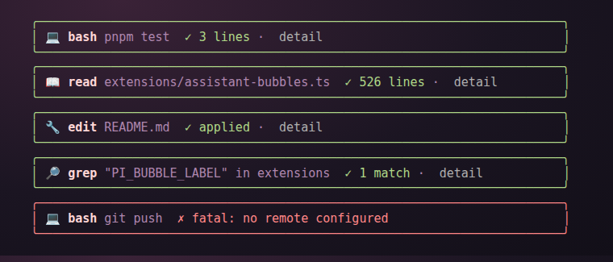
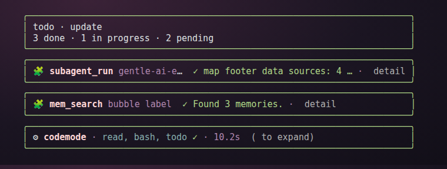

# gentle-shell-chat-bubbles

Chat-style UI for the [Pi coding agent](https://pi.dev) and
[Gentle Shell](https://github.com/MataM15/gentle-shell): the conversation reads
like a messaging app (speech bubbles, thought bubbles, compact tool cards), while
the terminal wallpaper stays visible because nothing paints a background.

Early-stage community preview. No dependencies beyond Pi itself.







## What is inside

| Path | What it does |
|---|---|
| `extensions/assistant-bubbles.ts` | Assistant replies in a rounded speech bubble with a tail; thinking in a dotted thought bubble; the user's own messages in a mirrored, right-aligned bubble. Compact layout under 60 columns (phone terminals). `/bubbles` toggles it. |
| `extensions/compact-tool-cards.ts` | `bash`, `read`, `grep`, `find`, `ls`, `edit`, `write` as one-line cards with an icon, a state-colored rounded frame and the outcome. Ctrl+O still expands Pi's native view inside the same frame. |
| `extensions/compact-other-tool-cards.ts` | Same treatment for the remaining built-in tools, subagent and todo cards. |
| `extensions/compact-codemode-card.ts` | Same treatment for codemode scripts. |
| `extensions/preventive-auto-compaction.ts` | Compacts the session early with instructions that preserve goals, decisions, task state and next actions. |
| `themes/sakura-dusk.json` | Soft pink and plum palette designed for a dark wallpaper. |

Each extension is independent except the two card extensions, which import
frame helpers from `compact-tool-cards.ts`.

## Install

Copy (or symlink) what you want into your Pi agent directory:

```bash
git clone https://github.com/MataM15/gentle-shell-chat-bubbles
cp gentle-shell-chat-bubbles/extensions/*.ts ~/.pi/agent/extensions/
cp gentle-shell-chat-bubbles/themes/sakura-dusk.json ~/.pi/agent/themes/
```

Then pick the theme with `/theme sakura-dusk` inside Pi. Restart Pi (or
`/reload`) after copying extensions.

### Options

- `PI_BUBBLE_LABEL`: the name shown on the assistant bubble. Defaults to
  `Assistant`; set it to whatever you call your agent.
- `PI_BUBBLE_USER_LABEL`: the name on your own bubble. Defaults to `You`.
- `/bubbles`: toggles the bubble renderer at runtime.

## Test

Tests render the extensions against your installed Pi and compare rows byte by
byte. They need a Pi install under `~/.pi/agent/npm/node_modules` (or
`PI_NODE_MODULES` pointing at one).

```bash
pnpm test
```

## Screenshots

`node --experimental-transform-types scripts/screenshots.mjs` re-renders the
images in `docs/` from the extensions and the theme, using a Chromium binary
(Playwright's headless shell by default, or `CHROMIUM`).

## Compatibility

Written against Pi 1.4 and Gentle Shell 1.4. The extensions use Pi's public
extension API (`@earendil-works/pi-coding-agent`, `@earendil-works/pi-tui`)
only; private layout internals are not touched.

## License

MIT.
